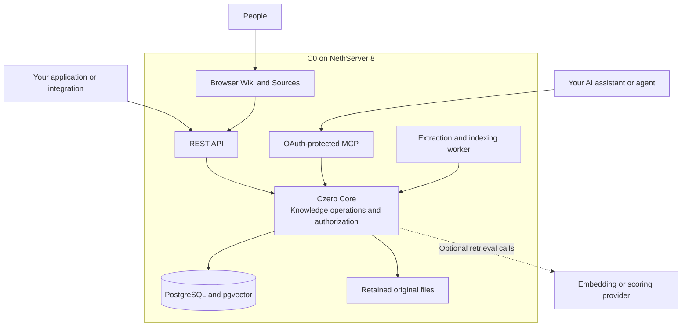
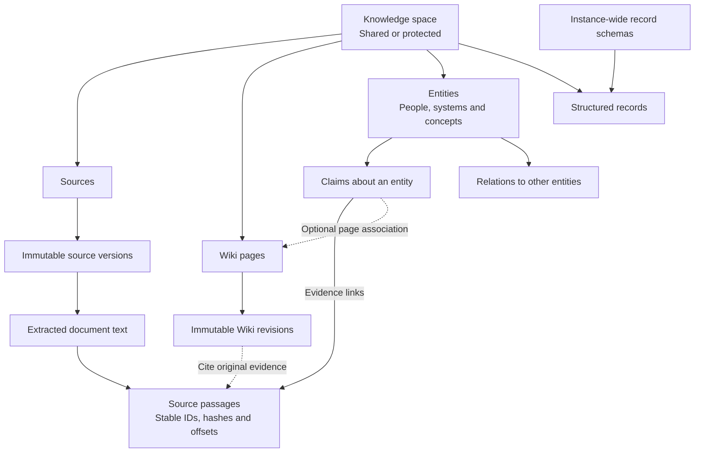

# C0 — A shared second brain for people and AI

**Keep what you learn. Find it again. Let your AI assistants build on it.**

C0 (Czero) is a self-hosted knowledge service: a Wiki, original sources and a structured knowledge graph that people and AI assistants can use together. It stores knowledge independently of a chat or model, makes it searchable through a browser and APIs, and controls who can read, write or manage it.

C0 takes the idea behind [Andrej Karpathy's LLM Wiki](https://gist.github.com/karpathy/442a6bf555914893e9891c11519de94f)—turn sources and useful answers into lasting, connected knowledge—and develops it into a shared application. Indexed retrieval, multiple users, protected spaces and an OAuth-protected MCP server provide the infrastructure around that idea. This is an independent implementation of the pattern.

You can use C0 as your team's second brain, or fork it as the foundation of your own AI application. Think of it as **a “LAMP for AI” starting point**: reusable storage, permissions, APIs, skills and deployment tooling, with your chosen assistant doing the reasoning.

[Use C0](#use-c0) · [Connect an assistant](#connect-your-ai-assistant) · [How it works](#how-c0-works) · [Build your own application](#fork-c0-and-build-your-own-application) · [Roadmap](PLAN.md)

## What can C0 do for you?

| You want to… | C0 gives you… |
| --- | --- |
| Stop explaining the same background in every chat | A durable Wiki and source library that different assistants can read and maintain |
| Find the right information without searching a folder by hand | Indexed text search, linked knowledge, and optional semantic retrieval and reranking |
| Know where an answer came from | Original sources, immutable source versions, extracted passages and precise citations |
| Share knowledge with a team | Verified accounts, Reader/Editor/Admin roles, Shared and protected spaces |
| Keep AI edits accountable | Expected revisions, replay protection on supported mutations, retained Wiki history and readback |
| Connect your existing assistant | An MCP server, instance-specific skills and a generated ChatGPT plugin package |
| Build a specialized AI application | A reusable Python Core, reference web application, REST/MCP interfaces, tests and NS8 deployment machinery |

For example, a support team can retain troubleshooting procedures and the evidence behind them. A researcher can connect findings across papers while retaining the original passages. A product team can keep decisions, systems and structured records in one place, then use different assistants against the same authorized knowledge.

The useful loop is **collect → connect → ask → improve**. Your assistant can research, summarize and propose or make authorized changes; C0 keeps the resulting knowledge, evidence and history available for the next person or conversation.

For repeatable imports, start with the [ingestion samples](samples/ingestion/README.md):
a full GitHub project/contributor/document pipeline and shared Python helpers for
other sources. Public adapters and tests stay in Git; your instance `.env`, update
scripts, OAuth credentials, datasets and receipts stay in an ignored private job.

## Use C0

### Use an existing instance

1. Open your organization's C0 HTTPS address and sign in with your own account.
2. Choose Shared or a protected space you have access to.
3. Read the Wiki, browse Sources or search for what you need.
4. If you have Write access, use the page's Tools or an authorized assistant to maintain it. Add supported files through Source tools, or ingest selected text through MCP.
5. Read back saved changes and follow citations to the original evidence.

New verified users normally receive **Read** access to Shared. An administrator can grant **Write** or **Manage**, give access to protected spaces, or persistently block a user. Application approval, a person's permissions and disconnecting one connection are separate controls. See [Workspace access](docs/workspace-access.md).

Start with the [user guide](docs/user-guide.md), including the first-content walkthrough. You can use the browser without connecting an AI assistant.

### Run your own instance

C0 is packaged as a **NethServer 8 application**. Prepare an NS8 node, a compatible user domain/sign-in provider, and a hostname with trusted HTTPS. Install a tested C0 image, configure the hostname and owner, then open the instance's **Use with AI** page at `/agents`.

Follow the [administrator guide](docs/administration.md). The [accepted runtime in PLAN](PLAN.md#accepted-runtime-and-promotion--24-october-2026) records the current tested candidate and its exact image identities. There is no stable NS8 release tag yet; choose a recorded candidate deliberately rather than treating a moving development tag as a release.

A standard installation runs the application, PostgreSQL/pgvector and the extraction/indexing worker. Optional embeddings and scoring are configuration choices; ordinary text retrieval does not require an external model provider.

## Connect your AI assistant

C0 exposes **Model Context Protocol (MCP)** at your instance's `/mcp` URL. It lets an assistant discover available operations, search and read knowledge, follow evidence and make permitted changes. The same Core services enforce authorization behind MCP, REST and the web application.

Open `https://c0.example.org/agents` on your own instance. It provides the connection details and generated downloads bound to that hostname:

- **A `.skill` archive** for the instance's knowledge workflow.
- **A plugin `.zip`** that references your registered ChatGPT C0 app and includes setup, research and maintenance skills.
- **The MCP URL** for clients with their own connector configuration.

Installing instructions does not connect an account or grant access. Sign in through OAuth, review the requested permissions and complete any C0 application approval. Read, Write and Manage scopes remain independent. Short access tokens renew through refresh; explicitly consented background connections use an inactivity deadline and can be disconnected or revoked.

| Client | Connection route | C0-specific evidence |
| --- | --- | --- |
| ChatGPT | Custom MCP connection plus optional generated skill/plugin; [C0 setup guide](docs/chatgpt.md) and [packaged skills](docs/plugin.md) | Interactive OAuth read/write is verified. Packaged-skill web acceptance and unattended scheduled writes remain release gates. |
| Codex | Registered public OAuth client and exact loopback callback; [Codex MCP configuration](https://learn.chatgpt.com/docs/extend/mcp) | A dedicated OAuth connection, protected Wiki reading and an administrator-only read have been verified using the granted scopes. |
| Claude / Claude Code | Connect to the same remote MCP endpoint using the client's OAuth configuration; [Claude connector guidance](https://support.claude.com/en/articles/11175166-get-started-with-custom-connectors-using-remote-mcp) | The client supports remote MCP; C0 end-to-end acceptance is still to be recorded. |
| Grok | Custom MCP connector or an application using remote MCP tools; [Grok connector guidance](https://docs.x.ai/grok/connectors) | The client documents custom MCP; C0 end-to-end acceptance is still to be recorded. |

The generated ChatGPT ZIP is a client-specific package, not a universal installer. Other clients use their own MCP, OAuth and skill formats. C0 requires administrator-approved clients and exact callbacks; do not assume automatic client registration will work in every client. See the [interface reference](docs/reference.md).

After connecting, try a scoped request such as:

> Use C0 to search Shared for the backup procedure. Read the relevant Wiki page and cite the original source passages. Make no changes.

For maintenance:

> In the protected Operations space, read the existing procedure and the selected new evidence. Update only the requested section, preserve citations and history, then read back the saved revision.

Scheduled maintenance is an external assistant workflow. A working interactive connection or an automation lifecycle marked “completed” does not prove an unattended write succeeded; verify the saved revision and result. See the [roadmap](PLAN.md#roadmap) for the remaining acceptance work.

## How C0 works



The assistant supplies reasoning and synthesis. C0 supplies durable state and controlled operations. It does not need to host the assistant's model. Its worker runs registered extraction and maintenance jobs; scheduling an agent's reasoning happens in that agent's platform.

Persistent Wiki pages let later questions reuse earlier work. PostgreSQL indexes, bounded retrieval and incremental indexing serve the knowledge without repeatedly scanning a loose file collection. Optional vector search and reranking can improve relevance. Performance and answer quality depend on the corpus and configuration; see the [retrieval benchmark](docs/retrieval-benchmark.md) for measured evidence and limits.

### How the data is structured



This is a conceptual map of the main relationships, rather than every database table:

- **Sources and passages** retain the evidence behind an answer. A citation identifies the source/version/document/chunk and its location; a generated summary is not a substitute for that evidence.
- **Wiki pages and revisions** hold maintained explanations, procedures and syntheses. Updates create a new revision without discarding earlier ones.
- **Entities, claims and relations** connect concepts to each other and to evidence. Structured records let an application store domain-specific data under explicit schemas.
- **Applicability and verification annotations** attach to an exact content revision. A changed revision does not silently inherit an earlier verification.
- **Spaces are access and data boundaries.** Content belongs to a selected space; references and evidence stay within that boundary. Record schema definitions are instance-wide, while records are space-scoped.

## Skills for using C0 and building on C0

There are two audiences, with separate instructions:

| Audience | Included skills | Purpose |
| --- | --- | --- |
| People and connected assistants | `c0-setup`, `c0-research`, `c0-maintain-knowledge`, plus the instance-bound memory skill | Connect the right account, research with citations, and make authorized knowledge changes with revision/retry safeguards |
| Developers and coding agents | `c0-create-feature`, `c0-develop-core`, `c0-contribute-upstream`, `c0-upgrade-from-upstream`, `c0-evaluate-tools`, `c0-ingest-sources` | Extend an application, improve Core, contribute upstream, review upgrades, evaluate tool guidance and maintain repeatable source ingestion |

Skills describe how to work; Core enforces what is allowed. They do not grant permissions or install an autonomous agent in C0. Repository development skills are kept out of runtime images. See [AGENTS.md](AGENTS.md) for the coding-agent entry point.

## Fork C0 and build your own application

Use the full repository as a starting point when your application needs shared knowledge, evidence, structured records, OAuth, MCP and a browser UI. Add your domain and workflow instead of recreating those foundations.

### 1. Fork and choose your application

Fork with GitHub's Fork button, or with the GitHub CLI:

```sh
gh repo fork Stell0/ns8-czero --clone
cd ns8-czero
git fetch upstream main
git switch -c feat/my-knowledge-application upstream/main
```

The CLI sets up the original repository as `upstream`; if you cloned a fork manually, add and verify that remote first. Start from the latest original C0 main, preserving existing fork work in its own branches.

Decide who will use the application, what they need to remember, which records it needs and which spaces/permissions separate their work. For example: a support knowledge base, a research memory or a product operations assistant.

### 2. Give your coding agent the repository instructions

Start Codex, Claude Code or your preferred coding agent in the checkout. Give it a concrete request:

> Read AGENTS.md, README.md and PLAN.md. Use the C0 feature workflow to add a support knowledge application. Keep reusable authorization and knowledge behavior in Core; put our customer-specific UI and workflow in the application. Propose the data model, implement the agreed change, and verify it using a disposable database.

The [development guide](docs/development.md) supplies installation and test commands. The agent instructions and local skills explain which layer to change and how to build, test and deliver it.

### 3. Extend the right layer

| Location | What belongs there |
| --- | --- |
| `packages/czero-core` | Reusable Python domain services, authorization, migrations and knowledge contracts |
| `app` | Your web UI, HTTP/MCP adapters and application-specific behavior using Core services |
| `imageroot` and `ui` | NS8 lifecycle/configuration/backup and native administration settings |
| `plugins/c0-knowledge` | End-user skills and instance-bound package templates |
| `.agents/skills` and `docs` | Instructions for coding agents, contributors and operators |

Use the released Core dependency and frozen lock by default. Change Core deliberately when behavior is reusable; a fork-specific screen or workflow does not automatically require a Core change. If you need only the reusable library, the [standalone consumer example](examples/fork/README.md) demonstrates a smaller starting point; it is a development fixture, not a configured NS8 application.

### 4. Build, test and publish your own application

Choose your own module identity and container image namespace before publishing. Keep native labels, image references, lifecycle paths and CI permissions consistent. A fork publishes its own images; it must not publish the template's registry tags or replace upstream Core releases.

Before opening a feature PR, establish that the complete required base tests are green on the latest original C0 main. Add regression tests for your feature, rebase the branch onto that base and run the complete suite again, including the required Python/PostgreSQL/packaging, controller, schema, shell and native checks. Database-backed tests need a disposable PostgreSQL/pgvector database; skipped database tests do not establish a pass. CI also validates independently released Core compatibility, images, installation, upgrade and recovery. Follow [development commands](docs/development.md) and the [CI policy](docs/ci-policy.md).

Every contribution from an external fork to original C0 main requires full base and candidate checks before opening its upstream PR, including documentation-only contributions. Only internal documentation-only branches use the lightweight exception. Coordinate image/native checks on an authorized upstream branch where necessary; never copy upstream credentials into fork secrets. See [contributor requirements](AGENTS.md#tests-are-part-of-the-feature).

Install the maintained [NethServer development skills](https://github.com/NethServer/agents) when working on module packaging, containers, deployment or releases. They complement C0's repository skills.

### 5. Keep your fork maintainable

Fetch original C0 main regularly and keep development changes rebased on it. Resolve conflicts and rerun your feature tests as well as the base suite after each upgrade. Preserve frozen/deployed candidates; a rebase that rewrites one requires a new candidate and fresh acceptance.

Review Core dependency updates and managed infrastructure proposals through `c0-upstream.json` and `scripts/sync-upstream.py`. The updater preserves customized files for review rather than overwriting them. Use `c0-upgrade-from-upstream` for upgrades and `c0-contribute-upstream` for reusable contributions. When your improvement can benefit the C0 base, open a focused upstream PR using `c0-contribute-upstream` and the installed `nethserver-pr` skill. Keep application branding, private deployment information and unfinished work separate from those contributions. Update the Codex-facing tool catalog, plugin/skills and documentation alongside behavior changes; verify the connection after upgrading.

## Roadmap and project status

The knowledge service, browser readers, protected spaces, OAuth/MCP access, persistent background connections and people-first administration are implemented and accepted under the recorded development gates. This remains a **development candidate**, with no stable NS8 release or public plugin-directory listing claimed.

The next priority is dependable use by someone starting from the public documentation: finish packaged-skill installation acceptance, diagnose and verify unattended assistant runs, expand measured client compatibility and close the remaining release gates. Broader agent-memory work and external workflow integration follow their explicit acceptance gates.

Read the [simple roadmap](PLAN.md#roadmap) for order and completion criteria. Detailed historical test counts, frozen image identities and CI evidence remain in [PLAN](PLAN.md) and the [history archive](docs/history/PLAN.md).

## Documentation and license

[User guide](docs/user-guide.md) · [Administration](docs/administration.md) · [ChatGPT setup](docs/chatgpt.md) · [Plugin installation](docs/plugin.md) · [Development](docs/development.md) · [Interfaces](docs/reference.md) · [Documentation index](docs/index.md)

C0 and its reusable Core are licensed under [GPL-3.0-or-later](LICENSE). NethServer conventions are maintained in the [Development Handbook](https://handbook.nethserver.org/).

<details>
<summary>Historical section links</summary>

These anchors preserve links to the retained historical record.

<a id="c0-czero--application-foundation-for-nethserver-8"></a>[C0 (Czero) — Application foundation for NethServer 8](docs/history/README.md#c0-czero--application-foundation-for-nethserver-8)

<a id="historical-m20-renewal-acceptance"></a>[Historical M20 renewal acceptance](docs/history/README.md#historical-m20-renewal-acceptance)

<a id="accepted-m17-profile-identity"></a>[Accepted M17 profile identity](docs/history/README.md#accepted-m17-profile-identity)

<a id="historical-m18-tool-guidance"></a>[Historical M18 tool guidance](docs/history/README.md#historical-m18-tool-guidance)

<a id="current-runtime-m19-client-metadata-discovery"></a>[Current runtime: M19 client metadata discovery](docs/history/README.md#current-runtime-m19-client-metadata-discovery)

<a id="applicability-and-structured-retrieval-am4"></a>[Applicability and structured retrieval (AM4)](docs/history/README.md#applicability-and-structured-retrieval-am4)

<a id="purpose-and-boundaries"></a>[Purpose and boundaries](docs/history/README.md#purpose-and-boundaries)

<a id="current-interfaces"></a>[Current interfaces](docs/history/README.md#current-interfaces)

<a id="knowledge-website-m15-accepted"></a>[Knowledge website (M15 accepted)](docs/history/README.md#knowledge-website-m15-accepted)

<a id="install-and-configure"></a>[Install and configure](docs/history/README.md#install-and-configure)

<a id="sign-in-and-sharing"></a>[Sign-in and sharing](docs/history/README.md#sign-in-and-sharing)

<a id="persistence-and-backup"></a>[Persistence and backup](docs/history/README.md#persistence-and-backup)

<a id="remaining-roadmap"></a>[Remaining roadmap](docs/history/README.md#remaining-roadmap)

<a id="development-and-verification"></a>[Development and verification](docs/history/README.md#development-and-verification)

<a id="nethserver-sources-and-license"></a>[NethServer sources and license](docs/history/README.md#nethserver-sources-and-license)

<a id="forks-and-core-distribution"></a>[Forks and Core distribution](docs/history/README.md#forks-and-core-distribution)

<a id="agent-memory-development-track"></a>[Agent memory development track](docs/history/README.md#agent-memory-development-track)

<a id="agent-workflow-guidance-am6-accepted"></a>[Agent workflow guidance (AM6 accepted)](docs/history/README.md#agent-workflow-guidance-am6-accepted)

<a id="protected-space-contract"></a>[Protected-space contract](docs/history/README.md#protected-space-contract)

<a id="earlier-implementation-evidence"></a>[Earlier implementation evidence](docs/history/README.md#earlier-implementation-evidence)

<a id="development-ci-policy"></a>[Development CI policy](docs/history/README.md#development-ci-policy)

<a id="session-renewal-m20-corrected-runtime-accepted"></a>[Session renewal (M20 corrected runtime accepted)](docs/history/README.md#session-renewal-m20-corrected-runtime-accepted)

<a id="documentation-and-skills-release-readiness-phase"></a>[Documentation and skills release-readiness phase](docs/history/README.md#documentation-and-skills-release-readiness-phase)

</details>


## Research projects in development

The [WikiPlant compatibility track](docs/projects/WIKIPLANT_COMPATIBILITY.md)
implements reusable research state within existing protected spaces. The initial
[project contracts](docs/projects/PROJECTS.md) cover versioned configuration,
topics, authorization and a read-only project overview. Operational queue,
ingestion, monitoring, reporting and migration preparation have separate gates.
This branch does not migrate real projects, deploy an instance or activate schedules.
