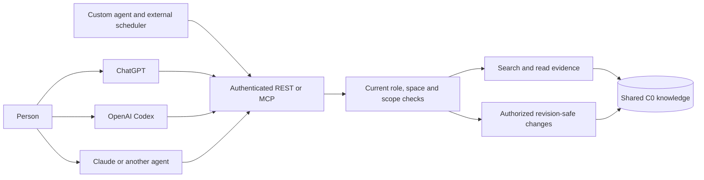
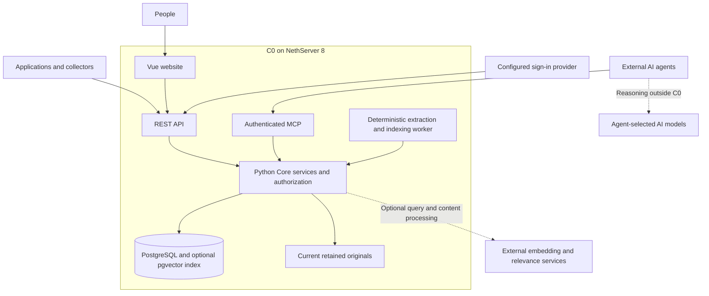

# C0 — Shared knowledge for people and AI agents

**Keep knowledge across conversations. Find its evidence. Use your preferred AI.**

C0 (CZero) is a self-hosted knowledge service and **Agentic RAG platform**. It gives people and external AI agents a shared Wiki, complete source documents, structured records and a knowledge graph. Agents can search, read evidence and maintain knowledge through authorized APIs and tools.

**Bring Your Own Agent (BYOA):** C0 stores and manages knowledge. You bring the conversational AI engine and model. C0 does not bundle or host a general-purpose conversational LLM or an autonomous agent runtime.

Use C0 for team procedures, support knowledge, ongoing research or project knowledge that must survive a chat or model change. You can also fork it to build an application on its reusable storage, permissions, APIs and delivery tools.

[Quick start](#use-c0) · [Connect an agent](#connect-your-ai-assistant) · [LLM Wiki guide](docs/llm-wiki.md) · [Documentation](docs/index.md) · [Roadmap](PLAN.md#roadmap)

## What can C0 do for you?

| Capability | What is implemented |
| --- | --- |
| Persistent knowledge | Wiki pages, source documents, schema-validated records, tags and explicit spaces |
| Original evidence | Complete extracted documents, retained originals when selected, exact passages, hashes and generation-bound citations |
| Retrieval | Document BM25 lexical ranking, exact structured filters, optional embeddings, hybrid ranking, relevance scoring and bounded graph context |
| Knowledge connections | Entities, aliases, sourced claims, relationships, applicability and revision-specific verification annotations |
| Ingestion | Text/Markdown through MCP; TXT, Markdown, PDF and DOCX file uploads; reusable external collectors for websites and other sources |
| Controlled processing | Background extraction/indexing, progress and recovery; opt-in queued extraction, local OCR and exact section/context reads |
| Shared access | Verified sign-in, Reader/Editor/Admin roles, self-service Read connections, space audiences, explicit OAuth scopes and personal API keys |
| Agent tools | REST, OAuth-protected MCP, instance-bound instructions and generated ChatGPT skill/plugin packages |
| Wiki maintenance | External agents can make requested edits or use an enabled, bounded compiler workflow with proposals, validation and readback |
| Research projects | Protected-space manifests, topic scope, monitoring/queue budgets, external workflow coordination and saved reports |
| Browser reading | Wiki, Sources, Projects and Explore; English/Italian, responsive pages and light/dark/system themes |
| Reusable base | Independently distributable Python Core, reference application, tests, fork-update tools and NethServer 8 packaging |

Ordinary text search needs no model provider. Semantic retrieval requires a configured embedding service and a ready index.
The [retrieval evidence candidate](docs/retrieval-evidence.md) adds bounded query
normalization, supporting passages and opt-in contextual embeddings. Optional scoring can rerank or filter candidates. See [retrieval behavior and measured results](docs/retrieval-benchmark.md); a ranking score does not establish that an answer is correct.

## Agentic RAG and Bring Your Own Agent (BYOA)

In Agentic RAG, the external agent decides what to retrieve, follows references, reads original context and combines the evidence into an answer. It can then make a separately authorized knowledge change. C0 supplies the persistent state and controlled operations for that work.

| C0 | External agent |
| --- | --- |
| Stores and organizes knowledge and evidence | Reasons, plans and talks with the user |
| Extracts, indexes and retrieves content | Chooses tools and reads enough evidence |
| Enforces current roles, spaces and scopes | Researches, synthesizes and assesses uncertainty |
| Checks revisions, evidence identities and supported writes | Decides when to propose or make an authorized update |
| Stores workflow state and maintenance outcomes | Runs recurring reasoning through its own scheduler or an external host |

ChatGPT, OpenAI Codex, Claude and custom agents use their own connection and instruction formats. Vendor MCP support and tested C0 compatibility are separate facts; see [connection guidance](docs/byoa.md).

C0 goes beyond a vector index of retrieved chunks. Complete documents remain readable, Wiki pages hold maintained explanations, and entities and sourced claims connect knowledge. Exact citations and current-content checks keep evidence identities explicit. Vectors are optional derivatives. Configured embedding or relevance services can process selected content internally; they do not turn C0 into a conversational AI engine.

## LLM Wiki

C0 develops the [LLM Wiki pattern](https://gist.github.com/karpathy/442a6bf555914893e9891c11519de94f): an external agent reads original sources and turns useful findings into connected, lasting knowledge. People can inspect the Wiki and evidence in the browser and ask an authorized agent to revise it.

A Wiki can start as a small topic collection in an ordinary space. A protected research project adds a manifest, approved topics, research budgets and report workflows when needed. There is no separate “Create LLM Wiki” wizard. Use [the complete LLM Wiki guide](docs/llm-wiki.md) for both setup paths.

**Searching does not update the Wiki.** Reader access cannot publish knowledge or queue learning. With effective Write access and an explicitly enabled retrieval-feedback policy, a compatible agent may submit one bounded improvement proposal after answering. That proposal does not publish a page. Requested edits and compiler publication are separate operations. [Update triggers and safeguards](docs/llm-wiki.md#what-happens-after-a-search) explain the exact rules.

[Daily and weekly maintenance](docs/wiki-maintenance.md) uses an external assistant and scheduler. Downloading a package or copying a prompt installs no task. Compiler capabilities are implemented, but the [latest measured compiler study failed its quality gates](docs/knowledge-compilation/RESULTS.md); automatic compilation is not an accepted retrieval improvement or a default-on rollout.

## How C0 works

Core owns domain services, transactions, persisted authorization and migrations. The application supplies REST/MCP and the Vue 3/Nebula website. NS8 provides lifecycle, settings and backup operations; its settings UI uses Vue 2/Carbon. The worker executes registered deterministic jobs. It does not execute user prompts or arbitrary shell commands. See [data, ingestion and retrieval diagrams](docs/architecture.md).

Source documents and Wiki pages retain **one current complete content generation**. Replacements publish atomically after validation. Superseded exact evidence returns `content_superseded` (410); stable links open current content. Before upgrading an older installation, back up and run the [latest-only migration preflight](docs/latest-only-migration.md).

## Structured tables candidate

The table browser in development lists populated record collections in the selected
space and renders their registered schemas with Nebula tables, filters, sorting,
column selection and record details. See [the contract and acceptance record](docs/structured-tables.md).
Released-Core adoption and native acceptance are tracked separately from implementation.

## Use C0

### Use an existing instance

1. Open your organization's C0 HTTPS URL and sign in with your own account.
2. Choose Shared or an authorized protected space.
3. Read Wiki, Sources or search results. Follow source references to the complete document.
4. Connect an agent if you want conversational retrieval or authorized Wiki maintenance.
5. With Write access, use **Sources → Upload source** to add a supported file. Wait for extraction, then inspect the saved evidence.

New verified users normally receive Read access to Shared. Administrators choose one cumulative access level: Read, Read and write, or Read, write and manage. They also manage protected-space access and persistent blocks. Application approval, a person's permissions and disconnecting one connection are separate controls. Application consent permissions remain independent selections. Start with [the user guide and first-content walkthrough](docs/user-guide.md).

### Run your own instance

C0 is packaged as a **NethServer 8 application**. Prepare an NS8 node, compatible sign-in provider/user domain, DNS hostname and trusted HTTPS. Install a reviewed immutable candidate, then configure the hostname and owner in NS8 Settings.

Follow [installation and administration](docs/administration.md) and the [candidate selection record](docs/installation-candidate.md). There is no stable NS8 module release tag. The source tree, released Core dependency and installed runtime can have different versions; a merge does not upgrade an instance. [PLAN](PLAN.md) retains exact acceptance and installed-image records.

## Connect your AI assistant

The native OAuth callback repair is delivered in released Core0.46.0 and the
accepted app0.64.0 dedicated deployment. Approved portless HTTP loopback callbacks
accept a client-selected port with host/path, explicit consent and exact code
redemption checks. The [accepted deployment record](PLAN.md#native-oauth-accepted-deployment)
contains its checked source and immutable images. Start a fresh authorization
flow if an earlier request expired; a new application can still need administrator
approval. Actual Claude Code end-user acceptance remains a separate check.

Open **Use with AI** at `https://c0.example.org/agents` on your instance. Copy its canonical `/mcp` URL, configure your client's OAuth connection, sign in and consent to the required scopes. New clients can require administrator approval. Verify the returned profile and exact space before reading or writing.

The page also generates an instance-bound `.skill` archive and a ChatGPT plugin `.zip` for an existing registered app. These supply instructions; they grant no permissions. Other agents use their own formats. [BYOA setup](docs/byoa.md), [ChatGPT setup](docs/chatgpt.md) and [plugin packaging](docs/plugin.md) give the detailed steps.

A minimal end-to-end example:

1. Connect the intended account with Read scope and select its space.
2. Ask: “In this C0 space, find the backup procedure. Read the Wiki page and current original passages. Cite the evidence. Make no changes.”
3. If a change is needed, obtain effective Editor access and explicit Write consent. Ask: “Using only these selected current sources, update the named procedure in this same space. Preserve conflicting observations. Read back the saved revision and evidence.”
4. Open that page in C0 and inspect its current content. API or host completion alone is not readback proof.

For custom automation, [personal API keys](docs/api-keys.md) provide explicit Read/Write and selected-space bounds. They have no administration scope. [Recurring maintenance](docs/wiki-maintenance.md) explains unattended authentication and verification.
The Account form defaults to 90 days, accepts 1–365 days and offers an explicit
**Never expires** choice with a security explanation.

## Documentation and license

Start at the [documentation index](docs/index.md):

- [LLM Wiki creation and evolution](docs/llm-wiki.md)
- [Recurring Wiki maintenance and example prompts](docs/wiki-maintenance.md)
- [Architecture, ingestion and retrieval](docs/architecture.md)
- [User guide](docs/user-guide.md), [administration](docs/administration.md) and [workspace access](docs/workspace-access.md)
- [API/MCP reference](docs/reference.md), [full documents](docs/full-documents.md) and [retrieval measurements](docs/retrieval-benchmark.md)
- [Source ingestion samples](samples/ingestion/README.md) and [protected projects](docs/projects/PROJECTS.md)

## Fork C0 and build your own application

Fork C0 when your application needs shared knowledge, evidence, structured records and authorized agent tools. Keep reusable domain behavior in Core and application-specific UI/workflows in the application. Use the released Core dependency and frozen lock by default. Choose independent module/image identities before publishing a fork.

Read [development and contributing](docs/development.md), [AGENTS.md](AGENTS.md), the relevant [repository skill](.agents/skills/c0-create-feature/SKILL.md) and [CI policy](docs/ci-policy.md). The [standalone consumer fixture](examples/fork/README.md) demonstrates a smaller library consumer. Preserve application customizations and contribute reusable improvements through focused upstream PRs.

## Cross-space references

App0.65 adopts released Core0.47 for guarded outgoing links between objects, Wiki pages,
sources, entities and claims. REST/MCP list only current authorized summaries in
explicitly selected target spaces; content reads remain independently authorized.
There are no browser panels. [The contract](docs/cross-space-references-plan.md)
separates producer validation, immutable release, consumer adoption and deployment.
[Released-consumer full/native and publication acceptance](PLAN.md#released-core047-consumer-acceptance)
passes. The accepted installation remains app0.64/Core0.46; live deployment
remains separately authorized.

## Roadmap and project status

C0 remains a development candidate. [Release readiness](docs/release-readiness.md) separates source/native acceptance, client compatibility, packaged-skill use, scheduled execution and production deployment. No stable NS8 release or public plugin-directory listing is claimed. Use [the roadmap](PLAN.md#roadmap) for remaining work and [the documentation audit](docs/documentation-review.md) for implementation evidence and known gaps.

C0 and its reusable Core use [GPL-3.0-or-later](LICENSE). NethServer conventions are maintained in the [Development Handbook](https://handbook.nethserver.org/).

Historical section links

These anchors preserve links to the retained historical record.

[C0 (Czero) — Application foundation for NethServer 8](docs/history/README.md#c0-czero--application-foundation-for-nethserver-8)

[Historical M20 renewal acceptance](docs/history/README.md#historical-m20-renewal-acceptance)

[Accepted M17 profile identity](docs/history/README.md#accepted-m17-profile-identity)

[Historical M18 tool guidance](docs/history/README.md#historical-m18-tool-guidance)

[Current runtime: M19 client metadata discovery](docs/history/README.md#current-runtime-m19-client-metadata-discovery)

[Applicability and structured retrieval (AM4)](docs/history/README.md#applicability-and-structured-retrieval-am4)

[Purpose and boundaries](docs/history/README.md#purpose-and-boundaries)

[Current interfaces](docs/history/README.md#current-interfaces)

[Knowledge website (M15 accepted)](docs/history/README.md#knowledge-website-m15-accepted)

[Install and configure](docs/history/README.md#install-and-configure)

[Sign-in and sharing](docs/history/README.md#sign-in-and-sharing)

[Persistence and backup](docs/history/README.md#persistence-and-backup)

[Remaining roadmap](docs/history/README.md#remaining-roadmap)

[Development and verification](docs/history/README.md#development-and-verification)

[NethServer sources and license](docs/history/README.md#nethserver-sources-and-license)

[Forks and Core distribution](docs/history/README.md#forks-and-core-distribution)

[Agent memory development track](docs/history/README.md#agent-memory-development-track)

[Agent workflow guidance (AM6 accepted)](docs/history/README.md#agent-workflow-guidance-am6-accepted)

[Protected-space contract](docs/history/README.md#protected-space-contract)

[Earlier implementation evidence](docs/history/README.md#earlier-implementation-evidence)

[Development CI policy](docs/history/README.md#development-ci-policy)

[Session renewal (M20 corrected runtime accepted)](docs/history/README.md#session-renewal-m20-corrected-runtime-accepted)

[Documentation and skills release-readiness phase](docs/history/README.md#documentation-and-skills-release-readiness-phase)

