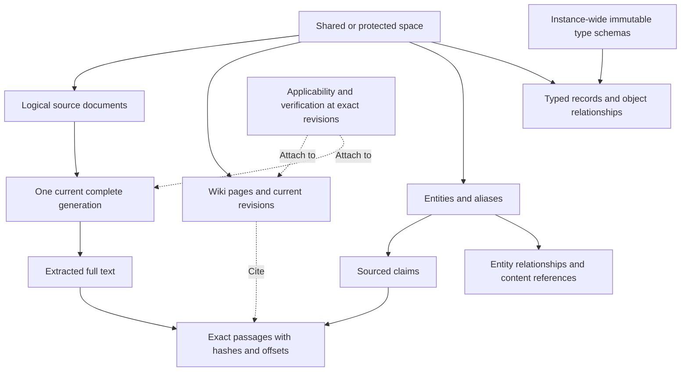
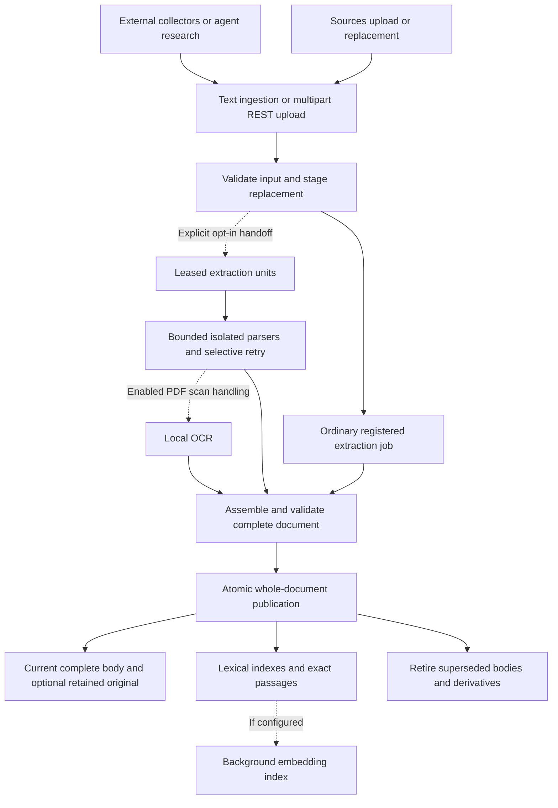
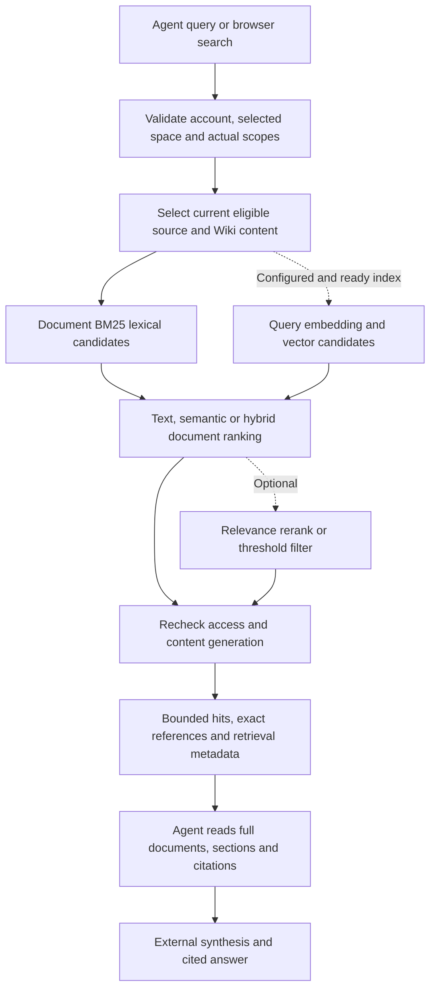

# C0 architecture and knowledge flow

C0 combines a reusable Python Core, a reference REST/MCP application, a Vue 3/Nebula website and NethServer 8 lifecycle/settings. PostgreSQL stores authoritative state; pgvector supports optional vector retrieval. Retained current original files use the instance's file storage. There is no separate graph database.

[The README system diagram](../README.md#how-c0-works) shows the service boundary. [BYOA](byoa.md) explains external agent connections. The diagrams below describe implemented operations, not a deployment or default-on rollout.

## Knowledge model

Space selection, current membership and actual delegated scopes apply to every content operation. Schema definitions are instance-wide; their records are space-scoped. Knowledge graph traversal supplements evidence retrieval. A relationship, claim or annotation does not prove the truth of its contents.

Source/Wiki bodies use [latest-only storage](latest-only-migration.md). Expected revisions protect concurrency. Exact citations identify a content generation; retirement returns authorized `content_superseded` (410), never replacement text under the old identity. Authored quotations remain authored text and invalidated evidence is marked stale. Payload-free change feeds and retry receipts do not provide body history or rollback.

## Document ingestion

Website crawling, GitHub collection and other acquisition run in [external ingestion samples](../samples/ingestion/README.md). Core does not fetch an arbitrary source URL. TXT, Markdown, PDF and DOCX use bounded extraction. Original file retention is opt-in. Readers keep the last complete publication while a replacement is staged; failed or partial work cannot replace it.

Ordinary extraction remains the default. The native `extraction.enabled` setting selects the queued-unit path; `ocr_enabled` is a separate opt-in for local Tesseract on unsupported PDF scan pages. The bounded worker pool and current-owned reuse apply to that path. They are not a promise of automatic OCR or cloud document processing. [The rollout guide](ingestion-pipeline/ROLLOUT.md) describes supported recovery and deployment gates.

A handled parser error marks processing failed and requires explicit retry. Unexpected deterministic job failures can use bounded job backoff. Queued units preserve successful work for selective recovery. Inspect the actual extraction state; job success alone may mean the handler recorded a parsing failure. Complete-document hashes, part membership and exact offsets must validate before publication. See [full-document contracts](full-documents.md).

## Retrieval

`knowledge_search` supports `auto`, `text`, `semantic` and `hybrid`. With configured embeddings, auto requests hybrid; otherwise it uses text. English/Italian normalization and document BM25 rank ordinary queries. Explicit query syntax and [structured applicability filters](reference.md) retain exact constraints. Source search keeps its citation-list contract; optional ranker metadata does not change evidence identity.

The [retrieval evidence producer](retrieval-evidence.md) adds search-specific
whitespace normalization and one exact supporting passage to hybrid hits. Its
opt-in contextual embedding format uses recorded labels and original ancestor
headings; these prefixes are derivatives and never replace citation text.

Provider absence/failure reports fallback and leaves ordinary text ranking available. Optional scoring uses bounded candidate excerpts and can rerank or filter when configured; filtering can return no hits. It does not establish factual verification. Current authority is checked before optional I/O and again before returning results. An optional bounded graph expansion can add connected context. See [retrieval options and measurements](retrieval-benchmark.md).

Retrieval does not queue a compiler job, revise Wiki pages or execute model reasoning in C0. [Optional agent-side post-answer feedback](llm-wiki.md#what-happens-after-a-search) is a separate write workflow.

## External maintenance

A research project adds protected-space scope, managed records, leases, budgets and reports. An ordinary Wiki needs none of that project setup. The separate compiler coordinates source-backed proposals and publication under an explicit selected-space policy. Both rely on an external agent for analysis and on an external host for recurring execution.

The app consumer selects an immutable released Core through `app/pyproject.toml` and `app/uv.lock`. The producer package can contain newer capabilities; current tool discovery determines what the installed server exposes. See [development](development.md) and [the review inventory](documentation-review.md) for current source/consumer distinctions.
