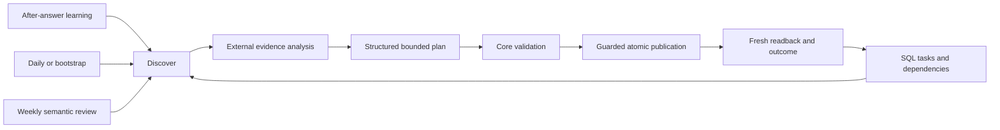

# SQL-backed knowledge compilation

Status: **M0 accepted in [PR80](https://github.com/Stell0/ns8-czero/pull/80); M1 accepted in [PR83](https://github.com/Stell0/ns8-czero/pull/83); M2 implementation candidate. M3–M6 are not implemented.**

[M1 contracts, interfaces and executed acceptance](M1.md) refine the additive
coordination milestone against its accepted predecessor. [M2](M2.md) records the
guarded publication and external-skill contract against current main. No publication,
deployment, production enablement or scheduler installation is authorized.
This plan targets original C0 main `13f0b94a06e6a6f7d4b74e8ddd3fe6ae6eea6aac`
(6 November 2026). App 0.59.0 consumes released Core 0.38.0 through its committed
`app/uv.lock`; schema is 0032 and plugin templates are 1.4.0. These identities
come from this checkout, not the initial task's older baseline. Preserve accepted
installed images and all other worktrees. This work authorizes no deployment,
Core publication, production enrichment, project changes or schedule installation.

The goal is an improving, source-backed Wiki: discover omissions and invalidated
support, compile useful concepts/procedures/relationships, verify saved knowledge,
and feed unresolved findings into later bounded work. SQL knowledge records are
the product. Neither a search cache, vectors nor an aggregate Markdown index can
replace them. Markdown bodies remain individual database values.

Read the normative [behavioral contracts](CONTRACTS.md), [baseline and acceptance
record](BASELINE.md), [CI policy](../ci-policy.md), [latest-only rules](../latest-only-migration.md)
and [controlled retrieval protocol](../agentic-retrieval.md) together. A future
milestone may refine an interface only with an explicit contract diff and tests.

## Reuse inventory

| Existing code | Reuse and limits |
| --- | --- |
| `packages/czero-core/src/czero_core/documents.py`, `document_context.py` | Current logical documents, multipart integrity, outlines/blocks/local references, selected context and exact revision/hash checks. Missing selective APIs use bounded whole-document reads, never truncated pseudo-documents. |
| `sources.py`, `current_content.py`, `document_units.py` | Ready publication, original/chunk identities, replacement tombstones, 410, incomplete extraction, current-only cleanup. Extraction units are not external multipart source parts. |
| `wiki.py`, `knowledge.py`, `annotations.py` | Pages, entities/aliases, graph links, immutable assertions with evidence, independent applicability/verification, current revisions and stale support. Search/resolve before create. |
| `bundles.py`, `receipts.py`, `spaces.py`, `operations.py` | Allowlisted atomic changes, payload-free replay identities, object-before-knowledge mutexes, persisted membership and delegated scopes. Add a guarded compiler caller; do not clone an operation interpreter. |
| `retrieval.py`, `structured.py` | PostgreSQL lexical search and exact applicability filters; optional vectors remain derivatives. Search stays read-only. |
| `projects.py`, `project_workflows.py`, `project_maintenance.py`, `project_schedules.py`, `project_reports.py` | Actor-bound leases/fences, ordered phases, shared budgets, audit cursors, rotating `project_semantic_select/review`, IANA occurrences and saved reports. Existing project records stay managed typed records; no project initialization for ordinary compilation. |
| `api_keys.py`, [API-key guide](../api-keys.md) | Personal Read/Write REST/MCP keys bound to explicit spaces and current permission revisions; no Manage scope or native-worker authority. OAuth remains supported. |
| `scripts/agentic_retrieval/layer.py`, `protocol.py`, `prepared.py`, `fixture.py` | Strict source-plan validation, namespaced stable identities, expected revisions, unchanged suppression, uncertain-write intents, leakage checks and matched disposable experiments. Its local ledger is experimental and not a multiworker policy/fencing service. Promote small reusable validators/client steps; do not import evaluation code into runtime. |
| `samples/ingestion/src/c0_ingest`, `c0_projects` | Existing authenticated client, private configuration/state/receipts, source snapshots and external workflow/report helpers. No second OAuth stack, collector or source mirror. |
| `.agents/skills/c0-maintain-semantic-layer` | Planning, dry-run/apply/readback, source-bound unverified navigation and recovery guidance. Keep experimental benchmark routing separate from the production skill. |
| `plugins/c0-knowledge`, `app/src/czero_app/agent_guidance.py`, `agent_packages.py`, `project_agent_packages.py` | Existing generic/project skill formats, exact app binding, capability-filtered guidance and deterministic safe ZIP generation. Current generic ZIP cap is 16 files/256 KiB; additions must fit or receive an explicitly justified bounded change. |
| `app/frontend/src/views/AgentsView.vue` | Selected-space copyable prompts, session/draft guards, downloads and capability-bound workflows; English/Italian in `app/frontend/src/locales`. No knowledge mutation on opening this page. |
| Existing ingestion, tool evaluation, retrieval benchmark and `tests/integration/test_agentic_retrieval.py` | Real disposable SQL/REST/MCP evidence, source-identical A/B fixtures, independent scoring and bounded external model calls. Do not make another benchmark harness. |

`knowledge_changes` is a commit-ordered knowledge feed, not a complete source
publication feed. `source_documents_list` currently uses bounded offset pagination.
M3 therefore needs trusted keyset source discovery in Core, including multipart
parents and disappearance reconciliation; clients must not pretend the existing
knowledge feed covers ingestion. Current project queues contain research questions
and scope/lineage policy, so they are not a generic space's compilation queue.

Do not duplicate source bodies, graph storage, typed schemas for existing concepts,
provider configuration, background authentication, extraction queues, project
schedulers, report engines or arbitrary command execution. Reuse existing typed
records only when a selected profile requires an already registered type. Default
compilation does not install schemas or infer taxonomies.

## Selected architecture

All entry points use DISCOVER → ANALYZE → PLAN → VALIDATE → APPLY → VERIFY.
Core supplies deterministic coordination and validation, never an LLM runner.
The external agent owns semantic reasoning, contradiction assessment, original
passage reading, deduplication and claims of limitations. The server validates
identity, freshness, policy, bounds and concurrency; that is not semantic truth.
Compilation starts only under an enabled selected-space policy. Retrieval learning
has an independent switch. Editor authority alone never opts a space in.

One small `CompilationService` in Core composes existing knowledge services.
The app adds strict REST DTOs and operation-registry MCP bindings. Ordinary
knowledge APIs retain their current signatures, limits, scopes and immediate
publication semantics. A separately authorized manual Wiki edit remains possible
when compilation is disabled; that does not authorize bypassing compiler policy
in an automatic workflow. Automatic agents expose only their allowed workflow
operations to the model, with source content separated as untrusted tool data.

## SQL design selected for M1

Reuse authoritative tables: `c0_wiki_pages`, current `c0_wiki_revisions`,
`c0_entities`, `c0_entity_aliases`, `c0_claims`, `c0_evidence_links`, `c0_relations`,
`c0_entity_links`, registered `c0_objects`/object relations, annotations and their
exact-content anchors, source/version/document/chunk tables, tombstones and
knowledge/object events and receipts. Retain existing GIN text indexes and
optional vector derivatives. The conceptual index is their scoped SQL joins.

Add **six** dedicated coordination tables, not another knowledge representation:

| Proposed table | Keys, data and reason |
| --- | --- |
| `c0_compilation_policies` | PK `space_id`; positive revision, enabled/feedback flags, publication mode, closed profile/version, target allowlist, positive finite daily/weekly/model/retry/concurrency budgets, timezone, actor and timestamps. No row means disabled. |
| `c0_compilation_runs` | UUID PK and unique `(space_id, kind, cycle_key)`; actor, policy/profile snapshot, due local occurrence/UTC instant, lease owner/deadline/fencing generation, attempts, state, bounded discovery/review checkpoints and coverage denominators, reserved/observed model usage, report identity/hash. Also stores daily budget windows; all run kinds share the same day allowance. |
| `c0_compilation_tasks` | UUID PK; unique `(space_id, dedup_key)` across terminal and active work; cause, canonical topic key, current target identity, source-set digest, policy/profile version, expected revisions, metadata-only observation, plan hash, state, run/fence reservation, attempts/backoff and bounded outcome IDs. Current proposals contain no source bodies, conversation or generated answer. |
| `c0_compilation_dependencies` | Composite unique `(space_id, target_kind, target_id, logical_document_id, evidence_identity)`; target revision/hash, source generation/full hash, physical version/chunk/hash/offset identity, compiler/profile version, managed target hash, stale reason and last verified time. Scalar identities survive source pruning; no FK to an expiring chunk/body. |
| `c0_compilation_sources` | PK `(space_id, logical_document_id, profile_id)`; last observed and last successfully compiled generation/hash plus ordered part-set digest, task/outcome identity and no-change/partial state. Tracks successfully considered sources even when they produce no Wiki record. Never stores body text. |
| `c0_compilation_events` | Append-only bounded payload-free task/run transitions, actor/fence, policy/plan hashes, counters, actual target revisions/hashes, failure/uncertainty codes and replay identity. Unique `(space_id, actor_id, request_key)` with request fingerprint; changed replay conflicts. No prompts, quotes, proposed page bodies or old receipt payload copies. |

Why not generic typed objects: dedicated compound uniqueness, efficient reverse
source dependencies, eligibility/lease queries with row locks and foreign-space
constraints are required. JSON object scans and process-local state cannot enforce
those invariants. Existing managed project object storage remains appropriate
for project scope, reporting and its fixed phases; do not migrate it.

All six tables carry `space_id`; FKs between them include space. Use closed
state/kind checks, positive monotonic revisions/fences, finite counters, bounded
JSON and hash lengths. Logical source/target tombstones retain opaque identities,
not deleted bodies. Profiles never store arbitrary executable code. Default
targets are Wiki navigation plus its unverified source annotations; entity, alias,
claim and relation targets require an enabled reviewed profile; typed objects
require existing explicit type identities. Authored records are never automatically
deleted or adopted solely because their title matches.

Required indexes/query paths:

| Query | Planned access path |
| --- | --- |
| Changed source → knowledge | Dependencies B-tree `(space_id, logical_document_id, source_generation, target_kind, target_id)`; compare current source identity/hash/part set. |
| Source → relevant concepts | Same reverse dependencies, existing entity links/aliases and scoped structured lexical search; no inferred access or vector requirement. |
| Outstanding proposals | Tasks partial B-tree `(space_id, state, not_before, id)` for eligible states; unique dedup key resolves exact repeats. |
| Stale knowledge | Dependencies `(space_id, stale_reason, target_kind, target_id)` plus current-identity anti-join. Staleness is effective immediately on mismatch, even before a bounded sweeper persists it. |
| Duplicate candidates | Existing exact alias/slug uniqueness, structured text search and tasks `(space_id, topic_key, profile_id)`; external semantic comparison records a merge into the selected actual target. |
| Coverage/status | Sources PK + runs `(space_id, kind, cycle_key)` and tasks by run/state; separate ready/seen/compiled/no-change/failed/unavailable counts and snapshot cutoff. |
| Recently changed Wiki | Existing current page/revision queries; add `(space_id, updated_at, id)` if EXPLAIN on representative cardinality requires it. Knowledge change cursor remains authoritative for knowledge events. |

M1 must verify constraints with real concurrent SQL sessions and EXPLAIN plans
at realistic cardinality; M0 does not claim indexes on nonexistent tables.

## API and tool contracts

M1 names are available in released Core 0.39. M2 names are implemented in the
producer candidate and omitted on older Core; M3 discovery remains proposed. REST prefix is
`/api/v1/compilation`; every call requires explicit `space_id`, including Shared.
MCP uses top-level `space_id` and typed `data` for mutations. No arbitrary SQL,
imports, expressions, URLs to fetch, commands or model/provider credentials.

| Milestone / MCP operation | REST | Authority and result |
| --- | --- | --- |
| M1 `compilation_policy_get` | GET `/policy` | Reader + `c0:read`; safe current policy/capabilities, disabled when absent. |
| M1 `compilation_policy_set` | PUT `/policy` | Admin + `c0:admin`; expected revision, replay key, affirmative enablement reference. API keys cannot configure policy. |
| M1 `compilation_status_get` | GET `/status` | Reader + Read; bounded coverage, current/stale counts, cursors, failures and actual successful runs; no private conversation material. |
| M1 `compilation_tasks_list`, `compilation_tasks_get` | GET `/tasks`, `/tasks/{id}` | Reader + Read; bounded filters/keyset pages and metadata-only outcome; targets remain separately authorized. |
| M1 `compilation_propose` | POST `/proposals` | Editor + Write, enabled policy and feedback switch for retrieval origin; validates same-space current references and canonical observation; returns admitted/merged/deferred/needs_review/no_change and task UUID/revision. |
| M1 `compilation_run_claim` | POST `/runs/claim` | Editor + Write; claim/resume/renew logical run, reserve bounded tasks/model allowances under policy and return actor-bound fence. No inference or knowledge publication. |
| M1 `compilation_run_checkpoint` | POST `/runs/checkpoint` | Editor + Write; live fence, expected task/run revisions, current phase and fixed outcome; stores recovery/usage observations, never fabricates verified publication. |
| M2 `compilation_plan_validate` | POST `/plans/validate` | Editor + Write; enabled policy and live run fence; no stored content mutation. Returns normalized plan hash, source/target identity digest, classification, eligibility and explicit errors. Validation is short-lived, not authority to publish later. |
| M2 `compilation_apply` | POST `/apply` | Editor + Write; same plan/hash/fence/policy, rechecks everything inside publication transaction, atomically commits bundle + dependencies + source outcome + receipt. Returns actual IDs/revisions/hashes, `applied_pending_verify`. |
| M2 `compilation_verify` | POST `/verify` | Editor + Write; records independently read-back exact current targets and original references, detects intervening edits, completes task only when proofs match. Read-only status never completes work. |
| M3 `compilation_discover` | POST `/discover` | Editor + Write; bounded keyset scan/invalidation/queue checkpoint under live fence, returns selected current summaries and next cursor, never source bodies in coordination records. |

New operations follow registry schemas/safety annotations and existing closed
error mapping, with read-only hints only on genuine reads. Mutations use
actor/space/request-bound replay keys; retrieval search keeps its existing
annotations and GET behavior. Read and Write scopes remain independent: a full
workflow needs both; current persisted role/space/key bindings are rechecked
inside each operation and after lock waits. Denied selection never falls back.
See CONTRACTS for plan fields, errors, leases, retry and latest-only recovery.

## Policy defaults and agent responsibilities

Absent policy: compilation disabled, retrieval feedback disabled, publication
`queue_only`. Explicit enablement retains queue-only unless separately changed.
Default profile `sourced-navigation-v1`: preserve originals, label synthesis and
unknowns, no verified status promotion, no automatic archive/delete/retraction.
Contradictions and uncertain applicability always need review. Review approval
is bound to a plan hash and exact source/target generations; edits invalidate it.
A reviewed plan can be applied by an authorized Editor even in queue-only mode;
no blanket approval of future plans.

Selected initial limits: daily 10 documents/10 target pages, weekly 20 documents/
10 reviewed pages; max 3 documents per task, 20 tasks per run, 100 outstanding
tasks per space, concurrency 1 (hard max 4), lease 300 seconds (60–900), 3 attempts
(hard max 5), 30-second doubling backoff capped at one hour. Daily model cap:
20 requests/100,000 reserved tokens; weekly work shares the day cap and has a
100-request/500,000-token weekly ceiling. Default external deadline 15 minutes
per run, 60 seconds per model request; one bounded retrieval assessment can use
at most 1 request/4,000 tokens, charged to the same day. Most episodes use zero
extra model calls by assessing already observed evidence only.

Limits are server ceilings, not claimed provider accounting. Reserve before an
external call; usage missing/uncertain consumes the reserved maximum and blocks
cost acceptance. Runner enforces model output/context/deadline locally; server
cannot constrain a malicious external client or prove its reported spend.
No provider configured means queue/dry-run can work but no claimed compilation.
Changing policy/timezone cannot refill an active budget window or resurrect leases.
Model use and retention/egress need an operator-approved provider and source scope.

## Bootstrap, daily, weekly and retrieval integration

Bootstrap uses bounded keyset inventory pages, acknowledges exact ready logical
revision/hash/part sets, and persists successes including justified no-change.
It stops PARTIAL with a cursor when any budget expires. It does not compile all
chunks independently, duplicate multipart parents or infer corpus coverage from
one batch. Newly published generations become eligible; unchanged sources and
unchanged relevant dependencies cause no new model calls or Wiki revisions.

Daily discovery compares publication identities to `c0_compilation_sources`,
marks mismatched reverse dependencies stale in bounded batches, and coalesces
revalidation and queued feedback. Failed extraction keeps the last complete
publication; a first incomplete document is ineligible. Archiving/deletion removes
eligibility, invalidates dependent support and retains authored knowledge. Missing
inventory entries are only finalized after a complete bounded scan cycle, never
from an offset page alone. Exact expired citations remain 410.

Existing projects keep one existing daily/weekly host task. Invoke compiler steps
within its existing maintenance/report flow, retain current project manifest/run
lease and compilation lease separately, cross-reference their actual IDs and
apply the stricter intersected scope/budgets. Store compiler outcome IDs/hashes
in the existing saved report metadata/text; project checkpoints reference actual
accepted Wiki/report/managed resources, not arbitrary new compiler UUIDs passed
to an unchanged project reference resolver. A configured project does not opt
its space into compilation. Do not extend PHASES or break old manifests simply
to add a compiler: use existing maintenance/checkpoint/report references; add an
optional compatible manifest binding only if required for discovery. No automatic
tracking/monitoring scope expansion or second host schedule.

Weekly projects reuse `project_audit_step`, `project_semantic_select` and
`project_semantic_review`. For ordinary spaces expose the same bounded selection
logic through compiler discovery, with a persisted rotating Wiki ID cursor plus
stale/consequential selections. Examine originals for technical assertions,
procedures, terminology/aliases, overlapping concepts, cross-document links,
applicability and contrary claims. Unsupported findings stay visible; approved
consolidation preserves authored text and all contrary evidence. Report selected,
reviewed, changed, no-change, deferred and unresolved counts with denominator and
cutoff. Completed selected review is not complete corpus coverage.

After answering a retrieval episode, the agent may assess a minimal source-backed
gap only when policy+feedback+Editor+Write permit it. An explicit read-only user
instruction takes precedence. No calls to mutation tools for Readers. Check exact
current Wiki/aliases and existing tasks before proposing; server dedup closes
races. At most one proposal per episode; no whole-corpus sweep, answer cache,
raw query, conversation, prompt, benchmark label or generated answer is stored.
The observation is a closed reason code plus source/target references and an
optional bounded source-derived concept label; no free-form user text. The answer
must remain deliverable when learning fails. Hosts unable to do work after a
final answer may perform only the bounded permitted handoff before ending the
turn or defer learning to a later host invocation; never claim invisible execution.
Queue-only is the default; low-risk automatic publication requires an expressly
enabled `automatic_supported` policy and M2 validation/readback.

## Skills, packages and Use with AI

M2 adds end-user `c0-knowledge-compiler`, with one shared normative reference and
capability checks; it is portable Markdown with existing REST/MCP contracts.
M4 updates `c0-research`; M2/M3 update `c0-maintain-knowledge`, `c0-projects`,
`memory-skill.md`, project daily/weekly/recovery templates and the experimental
semantic skill's routing. No new registered connection or app ID. Generic
archives remain separate from project-bound private handoffs. Current servers
without compiler operations offer ordinary research/maintenance and explain the
missing capability, rather than suggesting generic objects/jobs as a bypass.

M5 updates agent guidance, package `ASSETS`, offline/HTTP inventory, project
references, runtime Containerfile COPY inputs, closed runtime allowlists, native
downloaded archives and evaluation inventory tests together. Test **generated
and installed** `.skill`/ZIP contents for discovery, links, schema version,
injection resistance, determinism, size, language, exact instance/space/project
binding and older-server capability omission. Documentation alone needs no
artificial plugin version bump in M0.

The `/agents` page gets eight copyable English/Italian prompts: compile now;
bootstrap; improve after retrieval; daily; weekly; configure ChatGPT recurrence;
external cron/systemd setup; progress/failure inspection. Every prompt uses the
currently authorized selection and advertised capabilities. Project prompts bind
current manifest version/IANA timezone/local times; ordinary-space prompts use
an explicit policy timezone (default UTC), never the browser's guessed location.
Downloads/install/connection/permissions are distinct steps. Preserve read-only
page behavior, space response guards, local assets, clipboard fallback and
keyboard/theme/mobile coverage. No prompt installs or enables a task by itself.

## Scheduling architecture and acceptance

The scheduler lives outside C0. Native deterministic jobs may index/extract or
perform bounded registered bookkeeping; they never run compiler prompts.
M5 implements a reference runner in the independent ingestion/client package,
using its existing authenticated REST/MCP client and an explicitly selected,
pinned external model adapter with structured tool calls. Do not publish a CLI
invocation until its actual installed `--help`, dry-run and execution pass.
Use an allowlisted adapter/tool loop with no arbitrary shell: present evidence as
untrusted data, apply only through compiler APIs, journal request identities
before calls, reconcile uncertain C0 writes, and save an actual verified run.
Test the installed package, not a source-path-only script. Deterministic mocks
are regression controls; one actual authorized provider run on a disposable
space is separately required for the supported-adapter claim.

Preferred unattended auth: explicit space-scoped Read+Write API key for a current
Editor, created through the existing browser account flow. Secrets use host
credential files (0600 in 0700 directories) or systemd LoadCredential; key values
never enter argv, prompts, Git, task descriptions, URLs or normal/error logs.
No Admin key or new scope. Verified renewable OAuth is an alternative only when
the host actually preserves/renews its consented background connection. Revocation,
expiry, binding/account mismatch or denied space stop work without fallback.

Ship tested dry-run/daily/weekly/status/recovery commands and cron **and** systemd
examples with actual executable paths, working directory, bounded retries, state
permissions, no overlapping execution and visible exit codes. A frequent UTC
cron tick can ask the runner's IANA calendar whether a local occurrence is due;
never assume cron's host timezone or a fixed UTC hour preserves local schedules.
Systemd timers use explicit zone and Persistent recovery; the runner verifies
occurrence identity regardless of host wakeups. Test spring gaps/fall folds
against the existing project occurrence algorithm: one logical local cycle,
first eligible occurrence, no duplicate fold work. Coalesce missed equivalent
runs to the latest eligible occurrence; incomplete prior work resumes without
resetting budgets or claiming missed coverage. Configuration changes require
explicit schedule review. Preserve old tasks disabled/enabled as found.

The complete ChatGPT setup prompt must name the exact connection, installed
compiler/project skill, account/space/project, enabled learning policy, Read+Write,
daily and weekly content, IANA zone/local times, occurrence keys, report readback
and missed/incomplete recovery. Instruct the host to discover its actual scheduling
capability, inspect existing equivalent tasks, save/read actual host task IDs and
observe real due execution. If scheduled tools cannot access the connector/skill
or retain auth, report BLOCKED with the saved setup instructions. No successful
prompt generation, interactive OAuth, mock agent or host "completed" flag proves
scheduled compilation. Refresh official host guidance and test its current
account capabilities at M5; do not assume support from a vendor name.

## Test and measurement plan

M0 freezes public fabricated source/compiler-response fixtures; retrieval labels
are in a separate test input and never passed to construction. The source-only
and existing-profile controls exercise real PostgreSQL current-source search,
SQL-backed Wiki/entity/claim/link persistence, original readback, replay/no-change,
replacement/410, stale evidence and source prompt injection remaining inert.
They do not implement a compiler state machine in tests or pretend mocks prove
semantic truth. Existing suites supply policy-independent concurrency/auth,
space isolation, API-key, selective context and project cursor controls.

M1–M6 matrix in CONTRACTS assigns every desired case to its first meaningful
milestone: initial bootstrap, canonical/topic dedup, no-change, source replacement/
delete/failed extraction/multipart, contradictions, leases/fencing/crash recovery,
exact citations, Reader/scope/cross-space denial, policy/version limits, injection,
archive discovery and SQL query plans. Run against separate task-owned databases;
missing PostgreSQL is not a pass. Native full checks are automatic for new test
paths under current CI policy, even though M0 changes no runtime. Do not weaken
that policy or add a docs allowlist exemption to avoid native acceptance.

M6 reuses frozen source-only/enriched A/B disposable snapshots with identical
original IDs/generations/hashes, languages/product/version provenance and read-only
catalog. Build from source packets only. Use development/validation/sealed labels,
one-time held-out measurement, same models/resources/budgets; preserve failures.
Measure Recall@K/MRR with logical-parent dedup; complete-evidence and citation
validity against **observed current originals**; independently adjudicated answer
accuracy/unsupported assertions, ambiguity/contradiction and multi-hop behavior;
P50/P95 latency, observed model requests/tokens and reported monetary cost (unknown
when absent). Freeze thresholds before model calls using the existing protocol's
pilot thresholds; add zero unauthorized writes, zero invalid credited citations
and zero known product/version errors. M0 asserts no quality improvement.

Real acceptance uses the operator-selected existing documentation space through
verified membership/capabilities, initially read-only and dry-run. Runtime code,
fixtures and public plans contain no private UUIDs, hosts, tickets or taxonomy.
Representative voice/security/server manuals and authorized ticket questions are
selected privately. Mutations require a separately approved namespace/disposable
space, and import of private originals there requires its own authorization.
Do not alter the existing source corpus, configuration, scopes, schedules or
installed runtime. Record actual multiple searchable SQL Wiki/entity/relationship/
claim records and exact citations, no monolithic index, incremental/retrieval/
daily/weekly resumption, coverage, cost and quality. Without that authorization,
report M6 real mutation acceptance blocked while preserving synthetic results.

## Milestones and dependency graph

One independently reviewed upstream PR per milestone, accepted predecessor before
starting its successor. Core producer acceptance, immutable publication and released
consumer adoption are separate gates within the relevant milestone; a merged
producer PR does not change the consumer lock. If release/adoption needs a separate
focused PR, treat it as that milestone's prerequisite delivery, never batch the next
milestone. Re-fetch original main, preserve frozen candidates on successor branches,
review the complete diff, verify the actual C0 merge gate and required checks,
and use protected regular auto-merge only on the reviewed exact head. No deployment.

### M0 — architecture and baseline (accepted predecessor)

- Dependency: latest original main and existing read-only capability inspection.
- Scope/contracts: this plan, normative lifecycle/policy/API/SQL contracts, fabricated
  source/model fixtures, frozen source-only baseline, regression checks and acceptance
  evidence. No migration, operation, skill registration, runner or UI behavior change.
- Files: `docs/knowledge-compilation/{PLAN,CONTRACTS,BASELINE}.md`, fixture JSON/README,
  focused unit/PostgreSQL tests, root roadmap link only.
- Tests/acceptance: fixture hashes and separation, existing validator rejection,
  real relational publication/readback/current-generation control; unchanged base
  and candidate checks with exact sources, full CI/native as selected by policy.
- Compatibility/recovery: all runtime/schema/lock/plugin identities unchanged;
  retain failed private test evidence. No destructive migration or production writes.
- Deliverables: reviewable M0 PR, actual local/CI evidence and M1 handoff prompt.
- Stop: missing real baseline, unresolved security contract or failed required gate;
  the M0 session ended without starting M1. The explicitly authorized M1 follow-up
  and its source-bound acceptance are recorded in [M1](M1.md).

### M1 — durable compilation state

- Dependency: accepted M0; reread/refine these exact contracts against new main.
- Scope/contracts: six coordination tables, disabled policy, metadata-only proposals,
  dedup, bounded status, run reservation/checkpoints, lease/fence/usage windows and
  current-source dependency identity validation. No generative workflow/publication.
- Files: Core compilation service/schema/migration/tests; app transport/error/operation
  DTOs; Core README/API reference; schema health and wheel/archive inventory checks.
- Non-goals: source-wide sweeps, model SDK, project initialization, UI and schedulers.
- Tests/acceptance: real PG races, uniqueness, expired/stolen actor leases, revocation
  while waiting, queue cap, replay/conflicting payload, policy disable/version change,
  cross-space/Read-only/Write-only/API-key boundaries, no-body receipts, EXPLAIN at
  cardinality, migration twice, predecessor clean restore, independent Core package.
- Compatibility/security: additive next migration after actual current head; no
  automatic enablement/backfill, existing API/replay/lock order remains intact.
- Recovery/deliverables: durable failed/uncertain states and exhausted retries;
  exact full/native producer proof; immutable Core release and consumer verification
  only through separately authorized publication gates, never silently local fallback.
- Stop: stale worker can publish/checkpoint, authority bypass, missing DB cases,
  unbounded table scans or a consumer pinned to unsupported operations.

### M2 — generic external compiler

- Dependency: accepted M1 and available compatible Core capabilities.
- Scope/contracts: closed structured source-backed plans, dry-run/validation,
  guarded atomic bundle+dependency publication, readback verification, canonical
  concept matching and production `c0-knowledge-compiler` guidance. Default
  navigation profile plus explicitly approved entity/claim/relation profiles.
- Files: Core guarded bundle composition; app validate/apply/verify bindings;
  client validators/steps extracted from experimental layer; plugin compiler skill,
  maintain guidance and source/installed package regression tests.
- Non-goals: daily discovery/feedback hooks, arbitrary object schemas, scheduling.
- Tests/acceptance: deterministic model plans for multiple concepts, aliases,
  two-source relationship/claims, exact evidence, wrong hashes, contradiction holds,
  unsupported assertions, plan tampering, concurrent authored edits, rollback between
  every stage, lost apply response, unchanged/no-op and source prompt injection.
- Compatibility/security: no model in server; validate is not a lasting grant;
  automatic restricted profiles cannot delete authored records or promote verification.
- Recovery/deliverables: same replay identity after uncertain commit, readback actual
  revisions, metadata-only durable results, full/native and package proof.
- Stop: bundle commits outside fence/policy/source lock, stale citation substitution,
  duplicate conceptual identity or raw source-body retention in coordination records.

### M3 — bootstrap and incremental maintenance

- Dependency: accepted M2; policy remains operator-enabled only.
- Scope/contracts: keyset current-publication discovery, resumable bootstrap/no-change,
  reverse invalidation/revalidation, multipart/tombstone/incomplete handling, weekly
  rotating review, ordinary-space runs and existing project maintenance/report links.
- Files: Core discovery/identity queries, project maintenance shared selection helper,
  client compilation loop, project daily/weekly/recovery references, diagnostics tests.
- Non-goals: source collection, new monitored topics, automatic schedule installation.
- Tests/acceptance: interrupted inventory and generation churn, source insertion behind
  cursor, completed-scan deletion reconciliation, same hash/new identity, part shrink,
  failed replacement retains old complete source, no duplicate inference for unchanged
  bodies, two independent workers, review rotation coverage and project stricter caps.
- Compatibility/security: sources remain authoritative; project phases/manifests work
  without compilation; no hidden writes on GET or scope widening.
- Recovery/deliverables: pinned cutoff/cursors plus late-change catch-up, verified
  run summaries, failed source/dependency reasons, native backup/update/restore.
- Stop: skipped publications, stale knowledge marked current, initial-corpus claim
  based on a sample, duplicate project scheduler or unchanged content repeatedly inferred.

### M4 — retrieval feedback

- Dependency: accepted M3 and compiler tools present in real capability catalog.
- Scope/contracts: bounded after-answer observation, current Wiki/task checks,
  one deduplicated proposal or supported low-risk apply under explicit policy;
  `c0-research` learning guidance and corresponding capability descriptions.
- Files: research/maintenance skills, common compiler client assessment handoff,
  agent guidance/capability tests and retrieval episode regression fixtures.
- Non-goals: search API writes, Reader writes, query/answer logging or corpus analysis
  per episode. Policy does not override a user's explicit read-only task.
- Tests/acceptance: mostly no-change episodes, disabled/queue-only/automatic variants,
  Reader and missing Write tool omission, concurrent equivalent gaps, hostile source
  instructions, metadata sanitization and overhead/model budget/failure isolation.
- Compatibility/recovery: source/knowledge retrieval answer works independently;
  pending feedback resumes via normal tasks, never by saving conversation text.
- Deliverables: installed skill behavior on actual supported connector, actual proposal
  receipts and source-bound verification; full exact-source checks.
- Stop: learning failure prevents answer, raw queries/labels stored, or implicit writes.

### M5 — packaging, UI and external scheduling

- Dependency: accepted M4; current host/model capability verification.
- Scope/contracts: all generic/project archives, runtime inventories, eight selected
  prompts EN/IT, installed external runner and tested cron/systemd setup/recovery;
  complete ChatGPT scheduling handoff with real capability limitations.
- Files: package generators/downloads/CLI, guidance, plugin templates/references,
  Containerfile/audit/native inventories, `AgentsView.vue`, matching i18n, independent
  client runner/entrypoint/timer examples and operator docs.
- Non-goals: server model execution, deployment, production task activation, new
  connection IDs/scopes or fabricated cron executables.
- Tests/acceptance: installed CLI and wheel, mock then authorized real model/DB run,
  API-key expiry/revocation/log-redaction, archived skill discovery/readback,
  capability compatibility, real browser selection/theme/keyboard, timezone gap/fold,
  missed wakeups and uncertain provider result reconciliation. Observe actual due
  disposable host runs separately from manuals and report any unavailable platform.
- Compatibility/recovery: preserve app bindings; existing project host tasks updated
  only with activation authority, never duplicated; no task installed by downloads.
- Deliverables: actual setup/execution receipts, pinned supported adapter, cost bounds,
  native runtime audit and optional separately authorized host acceptance.
- Stop: secrets in argv/logs, absent CLI/model invocation, unsupported unattended auth,
  host cannot retain the skill/connector, or scheduled success lacks C0 readback.

### M6 — quality and controlled acceptance

- Dependency: accepted M5 and separately authorized private mutation namespace/provider.
- Scope/contracts: complete synthetic matrix, frozen A/B retrieval study, authorized
  representative documentation dry-run and disposable compilation/resumption,
  operational acceptance/rollout gates. Include ticket material only when authorized.
- Files: reuse retrieval protocol/builders/metrics, private manifests outside Git,
  sanitized `docs/knowledge-compilation` results and operational guide; regression
  fixes stay focused and revalidate their exact successor source.
- Non-goals: production import, deployment, stable release or schedule activation.
- Tests/acceptance: measured quality/citation/latency/calls/tokens/cost and corpus
  coverage; multiple SQL knowledge records/relations with original evidence; complete
  recovery/security matrix, native full gates and independent artifact audit.
- Compatibility/security: no held-out leakage, no provider/source scope expansion,
  no private UUID/hostname/ticket fixture in public changes, no unsupported truth claims.
- Recovery/deliverables: retain all failed/partial measurements and uncertainty;
  source-bound acceptance report distinguishes mock, manual, unattended and live proof.
- Stop: unauthorized data movement, citation or product/version regression, budgets
  exhausted, labels leaked, unavailable real model/host or unapproved live mutation.

## Next Codex prompt

> Implement M1 only from the accepted M0 PR and current original C0 main. Read
> docs/knowledge-compilation/PLAN.md, CONTRACTS.md and BASELINE.md, AGENTS.md and
> the Core/feature skills. Preserve the frozen M0 source/fixtures and all existing
> worktrees. Refine M1's six-table schema and strict operation contracts before
> runtime edits; implement disabled-by-default policy, metadata-only deduplicated
> proposals, fenced runs/budgets/checkpoints, status and dependency identities in
> reusable Core with thin REST/MCP adapters. Add real isolated PostgreSQL race,
> authority, replay, recovery, query-plan, migration and packaging tests. Run base
> and candidate checks plus selected full/native acceptance, review the complete
> diff and open one upstream M1 PR. Keep released Core publication/adoption gates
> separate; do not publish, deploy, enable learning, mutate production knowledge,
> install schedules or start M2.
