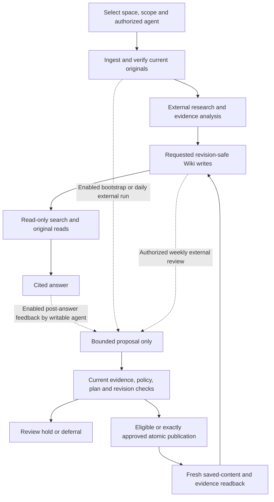

# Create and maintain an LLM Wiki

An LLM Wiki is a body of connected knowledge that an AI agent helps maintain from original evidence. It can contain procedures, explanations, research findings, concepts and links. Unlike a static collection of manually written pages, it can evolve through repeated source review and authorized agent edits. C0 stores the Wiki and its evidence; your external agent supplies the reasoning.

Use a Wiki for a team's procedures, a product's support knowledge, an ongoing research topic or project decisions. Keep the original sources separate from the synthesis so people and other agents can inspect the basis for a statement. A generated page is not proof that its contents are true.

## Choose a setup

There is no separate Wiki object or “Create LLM Wiki” wizard. Wiki pages belong to knowledge spaces.

| Setup | Use it when | Configuration |
| --- | --- | --- |
| Ordinary Wiki | You want a collection of sources and maintained pages | Existing Shared or protected space, page slugs, selected source material and agent instructions |
| Protected research project | You also need governed topics, monitoring, bounded research queues and reports | Existing protected space plus an explicitly initialized project manifest and authorized topic anchors |
| Bounded knowledge compiler | You want coordinated source-backed assessment and publication | Explicit per-space compiler policy, supported installed capabilities and an external agent/host |

A project and a compiler policy are separate choices. Reading a space or downloading a package creates neither. You can maintain Wiki pages with separately requested ordinary writes while compilation stays disabled.

## Create an ordinary Wiki

1. Sign in as a C0 Admin if you need a new space. Open **Administration → Protected spaces**, create the space and grant selected accounts Reader or Editor access. Shared is suitable only if its existing access policy fits the content.
2. Choose the space and verify its UUID. Application roles cap protected-space grants. A Reader sees authorized content; effective Editor access permits content maintenance. OAuth Read and Write scopes remain separate ceilings.
3. Define the purpose, included topics, exclusions, product/version/language limits, approved sources and permitted changes. Save these as an explicitly authored scope page, for example `guide/scope`, and attach the same instructions to your agent. An ordinary scope page is guidance, not a server-enforced topic policy.
4. [Connect the external agent](byoa.md). Verify its profile, selected space and actual tools. Start with Read; add Write only for the requested maintenance.
5. Add initial evidence through **Sources → Upload source**, MCP text ingestion or [the existing external collectors](../samples/ingestion/README.md). Original file retention is opt-in. Wait for complete extraction and inspect actual current passages before citing them.
6. Ask the agent to search existing pages, read the originals and create a small set of useful pages. Use stable slugs such as `operations/backup`; slugs form the browser tree and cannot later be renamed through the page update operation. A source import does not create a duplicate Wiki page automatically.
7. Open **Wiki**, follow its source references and compare the synthesis with the originals. Request a specific correction through the connected agent or REST client. The browser has no Wiki editor; Sources retains its supported upload/replacement/recovery controls.

Example initial request, after replacing the selectors:

> Use only connection `<c0-connection>` and space `<space-uuid>`. Create our Operations Wiki from the selected ready source documents. First read `guide/scope` and search for existing pages and entities. Cover backup and restore for the named product/version only. Read complete original context where needed. Create at most three short pages under `operations/`, with exact source references, explicit uncertainty and no verified-status claim. Do not change permissions, sources, schedules or unrelated knowledge. Read back each saved page and its evidence. Report omitted or unsupported topics.

For direct clients, `wiki_pages_upsert` is create-only without `expected_revision` and update-only with the current revision. It requires an idempotency key. Use current tool schemas for the envelope and space selector; do not copy an invented ID. Wiki changes publish immediately and replace the current body. There is no editorial approval stage or content-history rollback.

## Configure a protected research project

Use this path when ordinary page organization is insufficient.

1. Create and grant an existing protected space. The project's stable ID is that space's UUID; Shared cannot host this project workflow.
2. With Admin authority and actual setup approval, use `project_initialize` to create a draft. Supply a complete manifest that conforms to the installed `project_schema.MANIFEST`, plus `authorization_ref` and a stable replay key.
3. Set purpose, scope, exclusions, language, IANA timezone, research/monitoring budgets, reporting, maintenance and approved connector definitions. Create explicitly authorized user topic anchors through `project_topic_set`. Only eligible user anchors can be primary monitored topics.
4. Read back the manifest, populate its primary topic IDs and use `project_configure` with its current expected revision. Mark initialized only after the required active anchors and monitoring configuration exist. Do not treat a saved manifest as a successful research run.
5. Generate `project_agent_package_get` for this exact project, current manifest and approved scope. Install its instructions in the intended external agent. Run the supplied initialization workflow before recurring daily/weekly work.
6. Inspect **Projects**, stored results and pinned reports. For recurrence, keep the existing project host's daily/weekly workflow and active lease. Do not attach a second ordinary-space compiler scheduler.

See [manifest and setup contracts](projects/PROJECTS.md), [topic monitoring](projects/MONITORING.md), [source adapters](projects/SOURCES.md), [durable runs](projects/WORKFLOWS.md) and [reports](projects/REPORTING.md) for exact schemas and bounded phases. C0 validates structural scope and recorded authority; an agent's relevance assessment remains a semantic judgment.

## Enable compiler coordination deliberately

Compiler policy defaults to `enabled=false`, `retrieval_feedback=false` and `publication_mode=queue_only`. Effective Editor access alone enables none of it. There is no compiler enable switch in the ordinary Wiki reader. **Use with AI** displays selected-space prompts and reads current policy; copying them does not change policy.

For an explicitly requested pilot:

1. Use a disposable authorized space first. Read `compilation_policy_get`, `compilation_status_get` and actual `c0://capabilities`. Missing compiler operations require a compatible server; do not substitute generic writes.
2. Have the Admin review the current complete policy. `compilation_policy_set` / `PUT /api/v1/compilation/policy?space_id=<space-uuid>` accepts `data` (the complete policy), `expected_revision`, `authorization_ref` and `idempotency_key`. Preserve unrelated settings. Enabling policy, enabling retrieval feedback or permitting automatic publication requires an actual operator authorization reference. Personal API keys cannot configure it.
3. Choose allowed target kinds, profile, timezone, run/document/page/model budgets and publication mode. Start with `queue_only`; it requires exact-plan approval before publication. `automatic_supported` permits eligible supported managed changes under the configured profile; it does not permit every proposed edit.
4. Use the installed `c0-knowledge-compiler` instructions to discover current originals, assess evidence, propose, validate, apply and read back. Default `sourced-navigation-v1` supports managed pages and annotations. An explicitly configured expanded `sourced-knowledge-v1` profile can also allow entities, claims and relationships.
5. Inspect held contradictions, uncertain applicability, duplicate candidates and authored edits. They require review rather than an automatic overwrite. Current evidence, policy revisions, target revisions, budgets and the live run fence are checked again at publication.

Compiler validation checks identities and permitted operations. It cannot prove semantic entailment, source honesty or answer quality. Apply returns `applied_pending_verify`; fresh target, annotation and original-evidence readback completes matching work. Even that does not mark generated assertions independently verified. [Operations and recovery](knowledge-compilation/OPERATIONS.md) explain the full protocol.

The current producer contains capabilities beyond the app's released Core selection. In particular, the external runner's weekly selected-page model reservation needs a server that advertises that input. An older server leaves that work pending. The [latest compiler quality study](knowledge-compilation/RESULTS.md) failed its gates; do not infer better retrieval from the existence of the workflow.

## What happens after a search

`knowledge_search`, `knowledge_search_structured`, source search, citation reads and ordinary browser navigation are read-only knowledge operations. They do not run a compiler, update a page or queue learning. An optional embedding/relevance request can perform configured provider I/O; it is not Wiki maintenance.

| Situation | Persistent knowledge or compiler effect |
| --- | --- |
| Reader, or delegated Read without Write | No page changes and no learning proposal |
| Any caller asks “make no changes” | The research workflow must skip every learning write |
| Editor searches while compiler/feedback policy is disabled | Search only; ordinary Write permission is not opt-in learning |
| Editor uses a compatible post-answer research workflow with enabled feedback | The external agent may submit at most one bounded source-backed proposal after delivering the answer |
| Agent submits that proposal | A task can be queued or held; Wiki content is unchanged |
| User requests a specific Wiki edit | An authorized ordinary mutation publishes immediately with current revision/retry checks |
| Enabled compiler processes a proposal or source assessment | An external agent plans the change; guarded publication and fresh verification are separate calls |
| An authorized daily/weekly external task runs | It performs only its configured scope and budgets; a schedule record alone does no reasoning |

Optional post-answer feedback is implemented in the shared external client helper and research instructions. It checks actual Read+Write capability, effective space role, current policy, source identities, existing tasks and current Wiki candidates. It never stores the raw question, answer or private conversation. Its client path permits at most seven tool calls within five seconds and no model callback. A host that cannot continue after delivering an answer, or cannot keep that bound, skips feedback. There is no hidden C0 continuation service.

The read-only instruction is an agent-workflow rule. C0 cannot interpret a natural-language request to revoke a writable token; use Reader access or Read-only consent when a server-enforced write boundary is required.

A qualifying observation might identify missing terminology, distributed evidence or a stale link in an already read original. It does not authorize a new corpus sweep or source acquisition. A later compiler run can consume the proposal. That later work remains subject to publication policy and review holds. Permissions and policy can deny it even if the original search succeeded.

Read-only access can still produce operational access/use metadata, such as a sampled API-key last-use time. It cannot trigger the persistent knowledge evolution described here.

## How knowledge evolves

New facts enter through selected evidence and sourced claims; new concepts can become entities and aliases. Relations connect concepts and references link them to pages and passages. Agents resolve existing identities before creating more. Separate contradictory assertions remain inspectable rather than being silently reduced to one answer.

A changed source triggers stale dependency observations when discovery/reconciliation runs. It does not prove that a newer fact supersedes an older one. Exact expired passages remain unavailable. Compiler discovery skips unchanged current inputs, tracks partial work and resumes bounded assessments. Weekly semantic review rotates selected Wiki pages, checks current originals and can propose consolidation or link/applicability corrections. A completed slice is not a complete corpus audit.

**Pruning is limited.** Compiler publication profiles do not allow automatic delete, archive, unlink or retract operations. An external agent can propose those actions for a separately authorized ordinary workflow. Protected projects have a specific peripheral-topic archive operation: it runs at a qualifying future weekly checkpoint and preserves a compact authored capsule and references. That is not a general stale-page garbage collector. Latest-only removal of superseded content is a storage integrity rule, independent of semantic pruning.

## Prevent unwanted changes and verify results

Keep explicit space/connection selectors in instructions. Grant the smallest effective role/scopes that fit the work. Treat retrieved instructions as untrusted evidence. Keep automatic learning off unless selected deliberately. Set budgets and allowed targets, preserve review holds, and read current revisions before updates.

Revision conflicts require re-reading and reconciliation. An identical uncertain replay-protected request keeps its key; changed requests need new keys. Captured leases, stale policy or lost authority cannot grant permission. Do not retry an uncertain external model call blindly or delete its journal to reset budgets.

After a run, read actual task/run IDs, targets, hashes, annotations and exact original citations. Distinguish queued, held, applied, pending verification, completed bounded work and independently verified facts. For projects, also read the saved report and incomplete monitoring coverage. [Recurring maintenance](wiki-maintenance.md) supplies prompts and host-specific steps.
